# Auctioneer

An auction marketplace split into six Flask REST services, each owning its own
datastore, so a schema change in one service cannot break the services that call it.
Five sit behind their own MySQL database and the messaging service uses MongoDB.
Messages travel between services over RabbitMQ. The whole thing runs as 14 Docker
containers on a shared bridge network.

Built at the University of Chicago in a team of four.

## Demo

Every screenshot below is the running stack in a browser at `localhost:3309`.

### Signing in

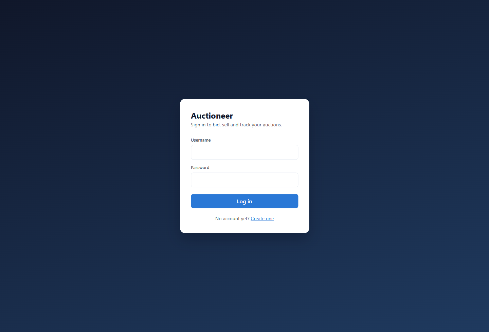

### Searching the catalogue

Search filters on item properties, so `categories:cameras` returns the items in that
category. A result with an auction open shows the highest bid and the closing time;
one without shows the asking price. Each card carries the actions that apply to it,
including buying outright, watching, and reporting the listing.

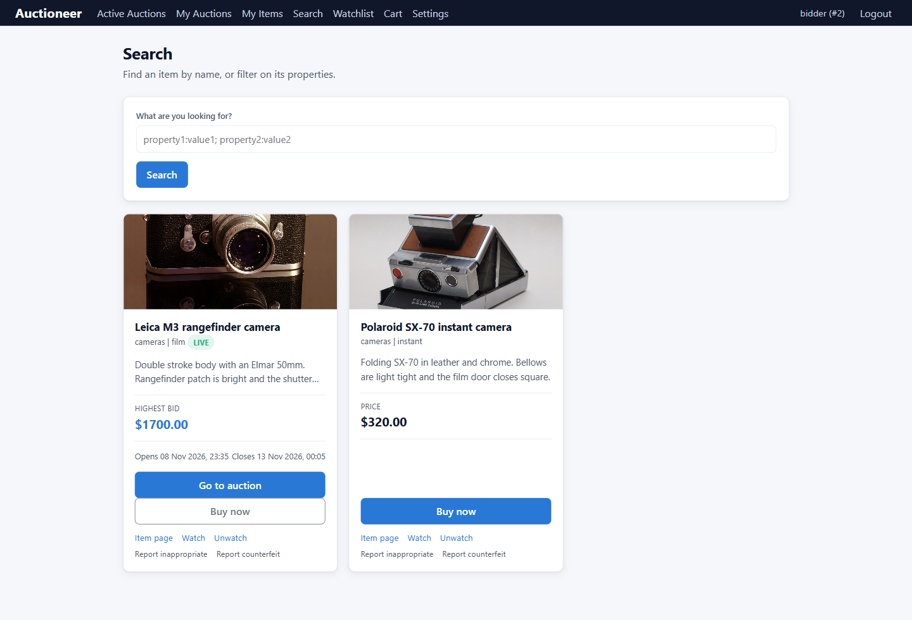

Every result links to its own item page.

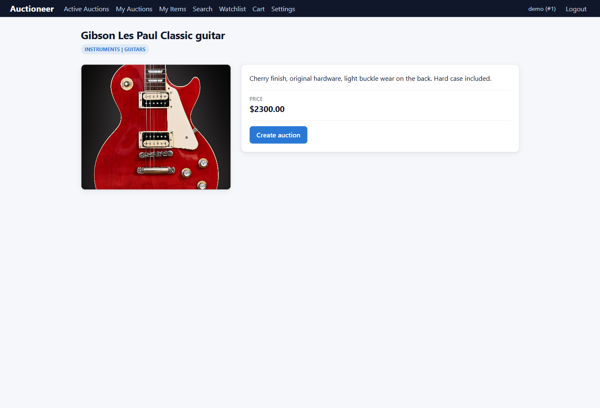

### Listing what you own

Each item carries the photograph you gave it, and you can open an auction on any
item that does not already have one.

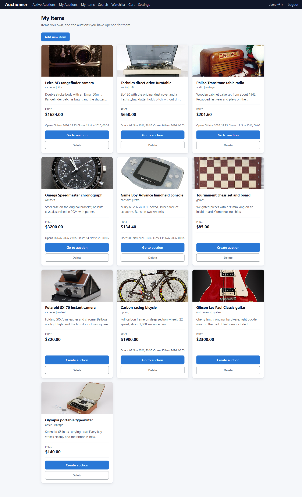

### The auctions you have opened

A seller sees the type of each auction, whether it is live, and where the bidding has
reached.

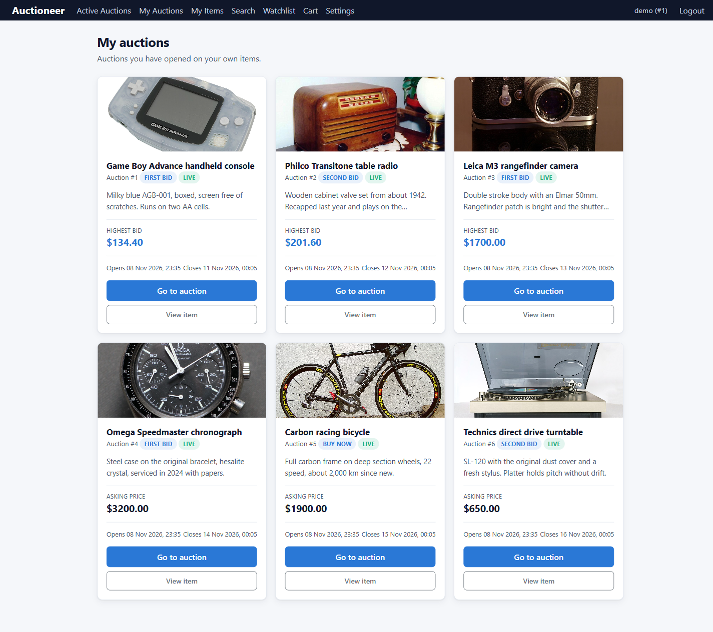

### Bidding

The auction page shows the item, the auction type, whether it is live, and the highest
bid so far. The controls for closing an auction appear only for an administrator.

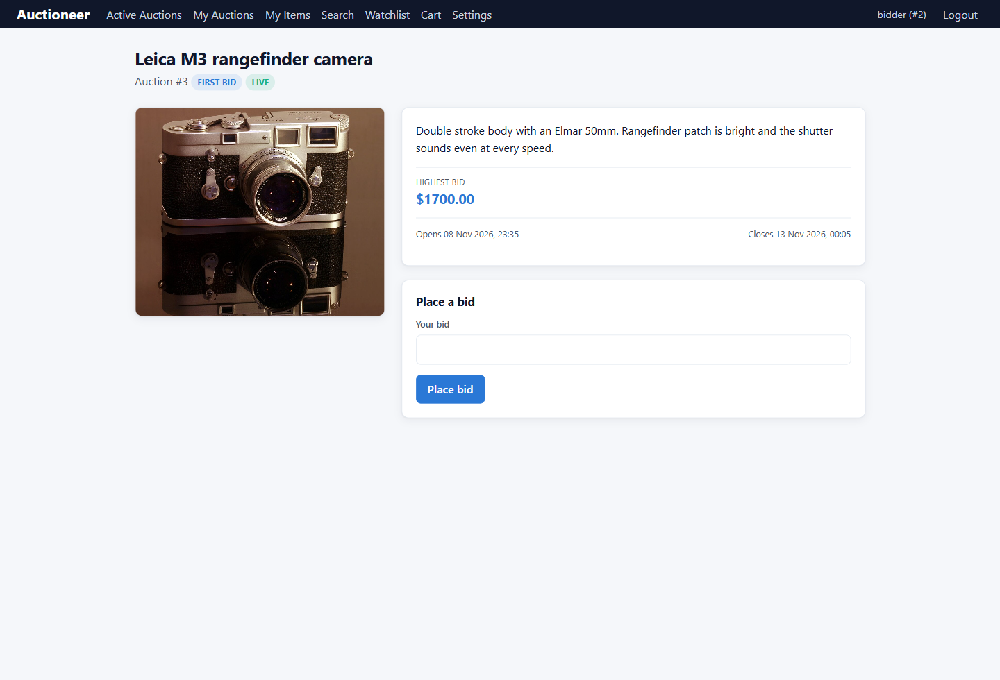

### Auctions you are in

Once you bid, the auction appears here with the item and the price the bidding has
reached.

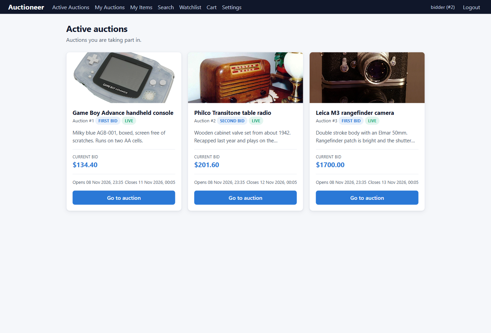

### Watching and buying

A watchlist follows an item without bidding on it, and the messaging service tells
the watcher when its price moves. Buying outright puts the item in a cart, which adds up
what it holds.

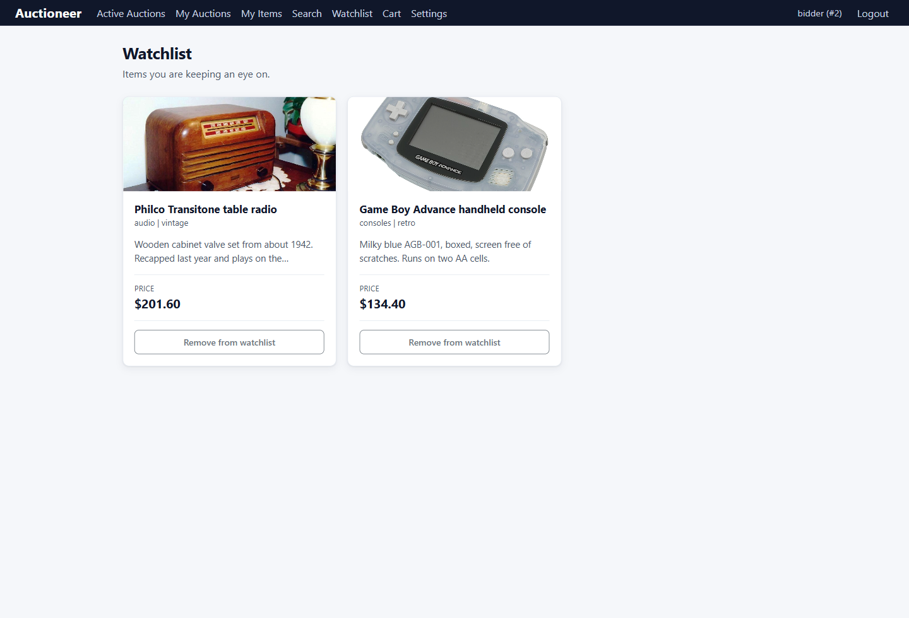

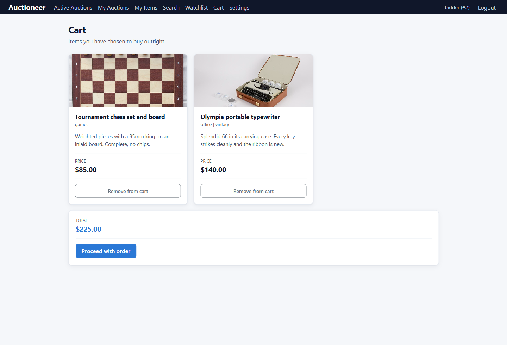

### Administration

An administrator moderates reported items, suspends or deletes accounts, edits the
category list, and reads every open auction on the site.

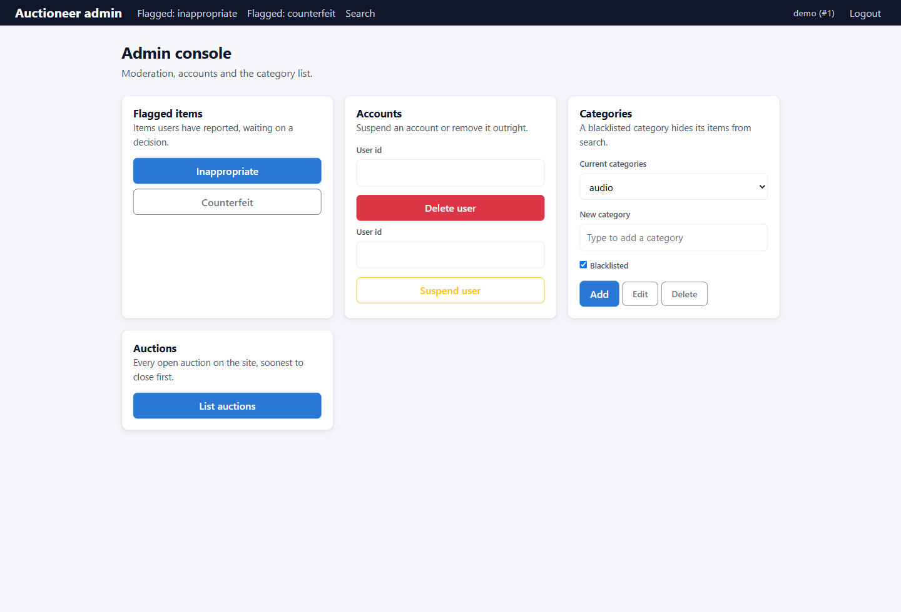

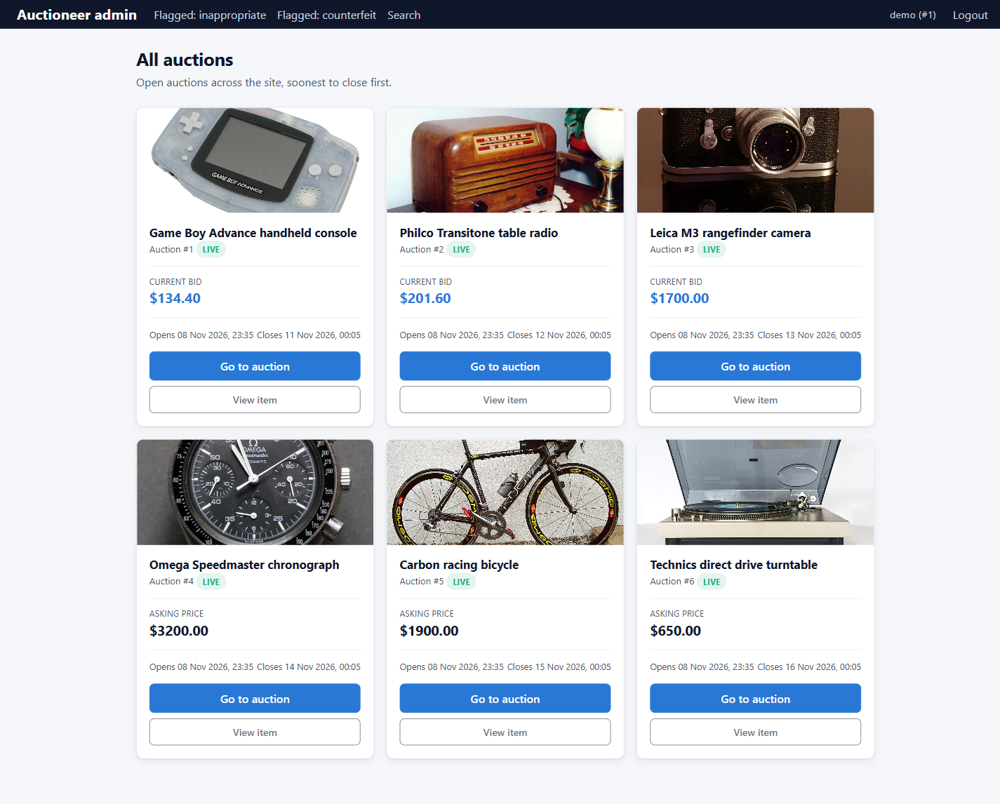

## How to run

You need Docker. Copy the example environment file and fill it in:

```bash
cd setup
cp .env.example .env
```

Then build and start everything:

```bash
./runscript.sh
```

The site is at `http://localhost:3309`. Create an account from the sign-in page, add an
item, then open an auction on it. An item takes a link to a photograph, which the
listing pages show. An item without one falls back to a lettered tile.

Every service waits for the database or broker it depends on, so a single
`docker compose up -d` brings the whole stack up in any order.

## Architecture

| Service | Port | Datastore | What it owns |
|---|---|---|---|
| frontend | 3309 | none | Flask templates and the browser-facing routes |
| items | 3307 | MySQL `itemsdb` | Item records, categories, reports |
| users | 3312 | MySQL `usersdb` | Accounts, login, admin flag |
| auctions | 3318 | MySQL `auctionsdb` | Auctions, bids, closing and winners |
| transactions | 3305 | MySQL `transactionsdb` | Cart and orders |
| watchlist | 3311 | MySQL `watchlistdb` | Items a user is following |
| messages | none | MongoDB `messagesmongo` | Support messages, email notifications |

The messaging service is reached over RabbitMQ instead of HTTP. Services call each
other by container name on the `netBackEnd` bridge network, and the frontend is the
only one published for a browser to reach directly.
